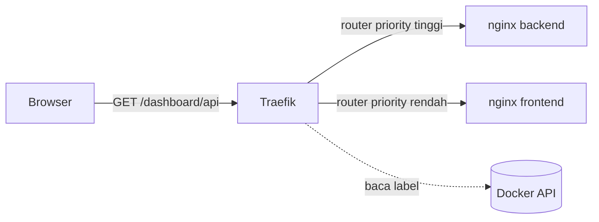

+++
draft = false
date = '2026-08-30'
title = 'Mengatasi Routing Path Overlap Traefik di Docker Compose'
type = 'blog'
description = 'Kenapa request ke /dashboard/api malah nyasar ke frontend, bukan backend, saat dua service berbagi path prefix di Traefik, dan cara benerin lewat router priority di label Docker Compose'
image = ''
tags = ['traefik', 'docker', 'docker-compose', 'routing', 'reverse-proxy', 'nginx']
+++

## Latar Belakang

Suatu ketika saya nambah backend ke satu aplikasi yang frontendnya sudah jalan di path `/dashboard`, semuanya di belakang Traefik dalam satu stack `docker compose`. Rencananya simpel, `/dashboard` tetap ke frontend, dan API-nya saya taruh di `/dashboard/api` biar satu domain, satu prefix, gampang diinget. Labelnya saya tempel di masing-masing container, `docker compose up`, kelihatannya beres.

Pas buka `/dashboard/api` dari browser, yang muncul malah halaman frontend, bukan respons backend. Saya refresh, ganti browser, buka incognito, hasilnya tetap sama, request yang harusnya nyampe ke backend malah lari ke frontend. Ini yang bikin saya bingung, karena rule backend jelas-jelas cocok dengan `/dashboard/api`, coba cek log di servicenya dan ternyata tidak ada request yang masuk. Di dashboard Traefik kedua router juga terdaftar rapi, tapi entah kenapa tidak bisa lari ke path `/dashboard/api`.

## Permasalahan

- **Request `/dashboard/api` masuk ke frontend**, padahal ada router terpisah yang rule-nya `/dashboard/api` dirouting ke backend.
- **Dua path prefix saling tumpang tindih**, `/dashboard` (frontend) adalah prefix dari `/dashboard/api` (backend), jadi setiap request API juga cocok dengan rule frontend.
- **Error tidak muncul sama sekali**, kedua container sehat, kedua router kebaca Traefik, jadi nggak ada log yang ngasih petunjuk ke mana masalahnya.
- **Gejalanya konsisten dari browser**, bukan cache, karena incognito dan curl polos pun hasilnya sama.

## Pendekatan Solusi

Setelah ditelusuri, akar masalahnya ada di cara Traefik milih router waktu satu request kebetulan cocok dengan lebih dari satu rule. Traefik nggak nyocokin request mengikuti urutan penulisan service di compose seperti dugaan saya, tapi ngurutin semua router berdasarkan **priority**, dari yang paling tinggi ke paling rendah. Router pertama yang rule-nya cocok, itu yang dipakai.

Nah, di sinilah letak masalahnya. Kalau priority nggak di-set sendiri, Traefik ngisinya otomatis dari **panjang string rule**, dengan asumsi rule yang lebih panjang itu lebih spesifik jadi lebih diutamakan. Di kasus saya, rule frontend kebetulan lebih panjang daripada backend, soalnya frontend saya kasih `Host(...)` sementara backend cuma `PathPrefix`. Gara-gara itu priority frontend jadi lebih tinggi dan selalu diprioritaskan, dan karena `PathPrefix(\`/dashboard\`)`juga cocok sama`/dashboard/api`, request API keburu dirouting ke frontend sehingga backend tidak mendapatkan requestnya.

Untuk memastikan `/dashboard/api` diarahkan ke service backend, ada beberapa opsi yang saya pertimbangkan, masing-masing dengan trade-off sendiri.

| Pendekatan                             | Kelebihan                                                        | Kekurangan                                                                                 |
| -------------------------------------- | ---------------------------------------------------------------- | ------------------------------------------------------------------------------------------ |
| **Biarkan Traefik yang atur otomatis** | Nggak perlu nambah config, `/dashboard/api` memang lebih panjang | Urutannya bisa kebalik begitu salah satu rule ditambahin matcher lain kayak `Host`         |
| **Set `priority` sendiri di backend**  | Pasti, logika routing-nya kebaca jelas, nggak ikut panjang rule  | Harus setup manual ketika ada path yang overlap                                            |
| **Ubah frontend jadi `Path` (exact)**  | Frontend berhenti nangkap sub-path di bawahnya                   | Frontend cuma cocok buat `/dashboard` persis, sub-path lain punya frontend ikut nggak kena |

Saya pilih **set `priority` eksplisit di router backend**. Buat saya ini paling masuk akal, logika routing-nya jadi kebaca jelas dan nggak gampang salah prioritas karena panjang rule-nya. Selama priority backend lebih tinggi dari frontend, request `/dashboard/api` dijamin nyampe ke backend duluan, mau nanti rule frontend ditambahin matcher apa pun.

## Implementasi Teknis

Biar gampang direproduksi, saya bikin dua container **nginx** polos, satu jadi frontend di `/dashboard` dan satu jadi backend di `/dashboard/api`. Masing-masing cuma balikin teks penanda supaya kelihatan jelas request nyampe ke container yang mana. Setup ini jalan di Ubuntu Server 22.04 dengan Docker dan Docker Compose sudah terpasang.

Struktur direktorinya seperti ini.

```text
traefik-routing/
├── docker-compose.yml      # definisi traefik + dua nginx
├── frontend/
│   └── default.conf        # nginx frontend, balikin penanda "frontend"
└── backend/
    └── default.conf        # nginx backend, balikin penanda "backend"
```

Alur request-nya digambarkan begini. Request masuk ke Traefik, lalu Traefik memilih router berdasarkan priority sebelum meneruskan ke salah satu container nginx.



### Menyiapkan Dua Container Nginx

Tiap nginx saya kasih config minimal yang membalas request apa pun dengan teks penanda dan path yang diminta. Ini file `frontend/default.conf`.

```conf
server {
    listen 80;
    location / {
        default_type text/plain;
        return 200 "frontend: $request_uri\n";
    }
}
```

Dan ini `backend/default.conf`, hampir sama tapi penandanya beda.

```conf
server {
    listen 80;
    location / {
        default_type application/json;
        return 200 "{\"service\":\"backend\",\"path\":\"$request_uri\"}\n";
    }
}
```

Dengan config ini, container mana yang benar-benar melayani request langsung ketahuan dari isi respons. Kalau `/dashboard/api` malah balik `frontend: ...`, berarti request-nya nyasar ke router yang salah.

### Konfigurasi yang Salah dulu

Ini versi `docker-compose.yml` yang mereproduksi masalahnya. Traefik saya jalankan dengan Docker provider lewat argumen `command`, jadi nggak perlu file statis terpisah untuk demo sekecil ini. Ketiga service saya taruh di satu network `proxy`, syarat wajib supaya Traefik bisa menjangkau container frontend dan backend lewat nama service. Tanpa network bersama ini, Traefik nggak akan bisa komunikasi ke keduanya dan request bakal balik `Bad Gateway`.

```yaml
services:
  traefik:
    image: traefik:v3.3.1
    restart: unless-stopped
    command:
      - "--providers.docker=true"
      - "--providers.docker.exposedbydefault=false"
      - "--entrypoints.web.address=:80"
    ports:
      - "80:80"
    volumes:
      - /var/run/docker.sock:/var/run/docker.sock:ro
    networks:
      - proxy

  frontend:
    image: nginx:1.27-alpine
    volumes:
      - ./frontend/default.conf:/etc/nginx/conf.d/default.conf:ro
    labels:
      - "traefik.enable=true"
      - "traefik.http.routers.frontend.rule=Host(`app.mnabila.com`) && PathPrefix(`/dashboard`)"
      - "traefik.http.routers.frontend.entrypoints=web"
      - "traefik.http.services.frontend.loadbalancer.server.port=80"
    networks:
      - proxy

  backend:
    image: nginx:1.27-alpine
    volumes:
      - ./backend/default.conf:/etc/nginx/conf.d/default.conf:ro
    labels:
      - "traefik.enable=true"
      - "traefik.http.routers.backend.rule=PathPrefix(`/dashboard/api`)"
      - "traefik.http.routers.backend.entrypoints=web"
      - "traefik.http.services.backend.loadbalancer.server.port=80"
    networks:
      - proxy

networks:
  proxy:
    driver: bridge
```

Coba perhatikan bedanya di rule kedua service. Frontend pakai `Host(\`app.mnabila.com\`) && PathPrefix(\`/dashboard\`)`, sedangkan backend cuma `PathPrefix(\`/dashboard/api\`)`. Secara path backend jelas lebih spesifik, tapi kalau diukur dari **panjang string rule**, frontend malah lebih panjang gara-gara ada `Host(...)`. Di sinilah bibit masalahnya. Jalanin stack-nya, terus tes.

```bash
$ docker compose up -d
$ curl -H 'Host: app.mnabila.com' http://localhost/dashboard
$ curl -H 'Host: app.mnabila.com' http://localhost/dashboard/api
```

Hasilnya, kedua request dilayani frontend.

```text
frontend: /dashboard
frontend: /dashboard/api
```

Request `/dashboard/api` yang mestinya ke backend malah dijawab frontend, sama persis kayak gejala yang tadi muncul di browser.

### Mengkonfirmasi Priority di Dashboard Traefik

Sebelum buru-buru benerin, saya mau mastiin dulu dugaan soal priority ini memang benar. Untungnya nggak perlu nebak, Traefik punya API yang nampilin priority tiap router yang lagi aktif.

```bash
$ curl -s http://localhost:8080/api/http/routers | \
    python3 -c 'import sys,json; [print(r["name"], r["rule"], r.get("priority")) for r in json.load(sys.stdin)]'
```

> **Note:** Endpoint `/api` cuma aktif kalau dashboard/API Traefik dinyalakan (`--api.insecure=true` untuk lokal atau lewat router khusus). Kalau nggak mau buka API, priority juga kelihatan di panel Routers pada dashboard Traefik.

Outputnya menunjukkan router frontend punya priority lebih tinggi, karena rule-nya lebih panjang.

```text
frontend@docker Host(`app.mnabila.com`) && PathPrefix(`/dashboard`) 52
backend@docker PathPrefix(`/dashboard/api`) 26
```

Angka `52` lawan `26` ini yang ngonfirmasi dugaan tadi. Frontend dites duluan dan langsung nyaut semua request di bawah `/dashboard`, termasuk `/dashboard/api` yang harusnya jatah backend.

### Memperbaiki dengan Priority Eksplisit

Perbaikannya ternyata simpel, cukup nambah satu label `priority` di router backend dengan nilai lebih besar dari priority frontend. Saya sengaja kasih angka yang jauh di atasnya biar aman kalaupun panjang rule berubah-ubah nanti.

```yaml
backend:
  image: nginx:1.27-alpine
  volumes:
    - ./backend/default.conf:/etc/nginx/conf.d/default.conf:ro
  labels:
    - "traefik.enable=true"
    - "traefik.http.routers.backend.rule=PathPrefix(`/dashboard/api`)"
    - "traefik.http.routers.backend.entrypoints=web"
    - "traefik.http.routers.backend.priority=100"
    - "traefik.http.services.backend.loadbalancer.server.port=80"
  networks:
    - proxy
```

Cuma satu baris yang nambah, `traefik.http.routers.backend.priority=100`. Sekarang giliran backend yang dites sebelum frontend, jadi request yang cocok `/dashboard/api` disambar backend duluan, sementara sisa request di bawah `/dashboard` tetap jatuh ke frontend. Deploy ulang, terus tes lagi.

```bash
$ docker compose up -d
$ curl -H 'Host: app.mnabila.com' http://localhost/dashboard
$ curl -H 'Host: app.mnabila.com' http://localhost/dashboard/api
```

Sekarang tiap request nyampe ke container yang benar.

```text
frontend: /dashboard
{"service":"backend","path":"/dashboard/api"}
```

`/dashboard` tetap ke frontend, `/dashboard/api` udah mendarat di backend. Masalah routing overlap beres cuma modal satu label.

## Tantangan yang Dihadapi

Yang paling makan waktu justru karena gejalanya nggak kelihatan kayak masalah routing sama sekali. Nggak ada error, nggak ada `404` atau `Bad Gateway`, request malah dilayani mulus, cuma sama container yang salah. Saya sempat curiga ke nginx duluan, ngira ada rewrite atau `try_files` yang salah nangkap path, padahal nginx-nya polos. Baru pas balik ke dashboard Traefik dan lihat dua router terdaftar rapi, saya ngeh masalahnya ada di lapisan pemilihan router, bukan di aplikasinya.

Saya juga sempat ngira urutan penulisan service di `docker-compose.yml` yang nentuin router mana yang dipilih, jadi backend saya pindahin ke atas frontend. Nggak ngefek sama sekali. Traefik nggak peduli urutan definisi container, dia murni ngurutin router dari priority. Di sinilah trade-off dari andalin panjang rule otomatis kelihatan, begitu salah satu rule dikasih matcher tambahan, urutan yang tadinya benar bisa kebalik tanpa peringatan apa-apa. Solusinya, ya berhenti gantungin diri ke panjang rule dan nyetel priority sendiri buat tiap path yang overlap.

Sempat juga kepikiran nambah middleware `StripPrefix` buat "misahin" path. Ternyata itu salah alat. `StripPrefix` cuma motong prefix dari path sebelum diteruskan ke backend, nggak ada hubungannya sama router mana yang kepilih. Kalau routernya saja udah salah pilih, mau ditambahin middleware apa pun di belakangnya ya percuma.

## Insight dan Pembelajaran

- **Traefik memilih router berdasarkan priority, bukan urutan tulis**, jadi mindahin urutan service di compose nggak pernah mengubah routing.
- **Priority default sama dengan panjang rule**, dan itu artinya rule yang secara path lebih spesifik belum tentu dipilih kalau rule lain kebetulan lebih panjang.
- **Path prefix yang overlap wajib priority eksplisit**, begitu satu path adalah awalan dari path lain, set `priority` di router yang lebih spesifik supaya deterministik.
- **Routing yang salah tanpa error itu wajar**, kalau dua container sehat tapi respons datang dari yang keliru, curigai lapisan pemilihan router dulu, bukan aplikasinya.
- **`StripPrefix` bukan alat untuk memilih route**, dia memodifikasi path setelah router terpilih, bukan menentukan router mana yang dipakai.

## Penutup

Jadi masalah `/dashboard/api` nyasar ke frontend ini sebenarnya bukan bug, cuma konsekuensi dari priority default Traefik yang ngikut panjang rule. Begitu satu path prefix jadi awalan path lain, cara paling aman ya nyetel `priority` sendiri di router yang lebih spesifik, biar routing nggak gantung sama kebetulan panjang string. Cuma satu label kecil, tapi logika routing-nya jadi jelas dan tahan kalaupun rule-nya diubah-ubah nanti.

## Referensi

- [Traefik HTTP Routers Rules & Priority](https://doc.traefik.io/traefik/reference/routing-configuration/http/routing/rules-and-priority/), diakses pada 2026-08-30
- [Traefik Docker Provider Documentation](https://doc.traefik.io/traefik/providers/docker/), diakses pada 2026-08-30
- [Traefik Routing Labels Reference (Docker)](https://doc.traefik.io/traefik/routing/providers/docker/), diakses pada 2026-08-30
- [Traefik StripPrefix Middleware](https://doc.traefik.io/traefik/middlewares/http/stripprefix/), diakses pada 2026-08-30
