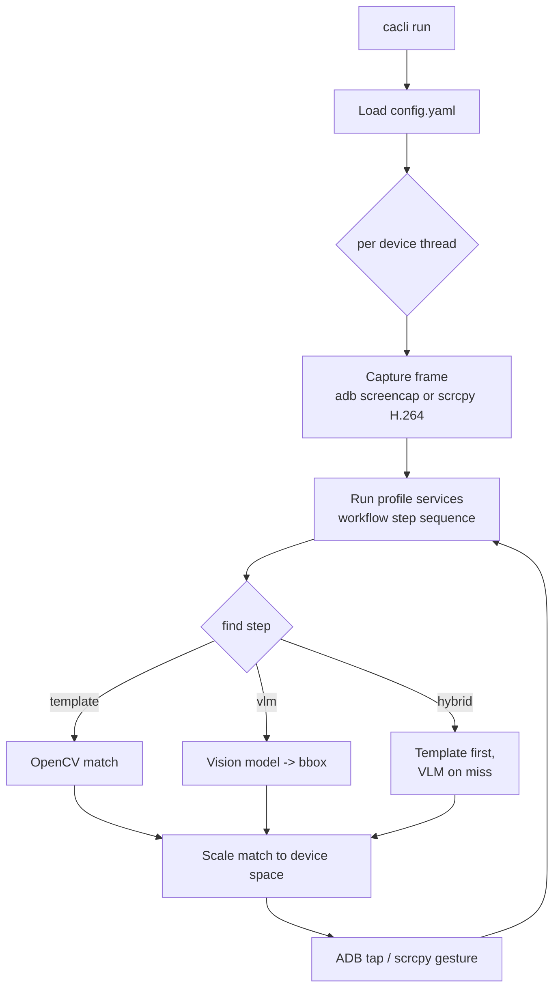

+++
draft = false
date = '2026-10-04T10:00:00+07:00'
title = 'click-agent'
type = 'project'
description = 'A Rust CLI that automates any Android screen from YAML workflows, combining OpenCV template matching with vision-model element finding and native scrcpy capture.'
image = ''
repository = 'https://github.com/mnabila/click-agent'
languages = ['rust']
tools = ['opencv', 'adb', 'scrcpy', 'tesseract', 'openh264', 'yaml']
+++

Automating an Android screen usually means writing code. Appium needs a driver and a test harness, accessibility-based tools need an on-device app, and the screen-scraping scripts I kept writing for repetitive game tasks were one-off Python glued to `adb shell input tap`. Every new app or screen meant editing code, and none of it survived a change in device resolution. Pure template matching is brittle the moment the UI uses a stylized font or the emulator runs at a different pixel density than the device I cropped templates from.

click-agent is a Rust CLI that turns screen automation into a config file. You compose workflows from primitive steps (find, tap, swipe, OCR, wait, loop, branch) in YAML, and run them on any device or emulator without touching code. Its differentiator is a hybrid vision layer: OpenCV template matching for the fast, free path, and an optional vision model that locates elements from a plain-language `prompt:` when a cropped template will not do. Define the behavior once in YAML, run it anywhere, let the model handle the parts that are hard to template.

## Problem Background

- **Every bot was bespoke code.** Each repetitive task I wanted to automate (collecting resources, tapping through menus) became its own throwaway script. There was no reusable engine, so the logic was never shared across apps.
- **Template matching breaks across resolutions.** A template cropped on a 1920x1080 emulator does not match on a 1080x2436 phone. Without auto-scaling, every device needs its own template set, which does not scale.
- **Stylized game fonts defeat OCR.** Tesseract reads clean UI text fine, but game counters with outlines, gradients, and decorative fonts come back as garbage.
- **Some elements resist cropping.** A button that changes color, moves, or appears in slightly different forms is painful to capture as a stable template.
- **ADB screencap is slow for a tight loop.** Polling the screen via `adb exec-out screencap` per cycle adds latency, and ADB `input` is single-pointer only, so gestures like pinch-to-zoom are impossible.

## Solution Overview

click-agent is a Rust workspace split into a reusable engine crate (`cacore`) and a thin CLI (`cacli`). The engine owns config parsing, ADB control, the vision layer, the scrcpy capture stream, and the workflow interpreter. Workflows are data, not code: a YAML file declares devices, profiles, and step sequences, and the engine executes them in a loop. Vision is pluggable per profile, you choose `template`, `vlm`, or `hybrid`, so the fast OpenCV path stays the default and the vision model is opt-in for the elements that need it.

The same vision model also powers `cacli gen`, which writes a complete validated config from a one-line description, and `ocr_engine: vlm`, which reads stylized text the way a human would instead of relying on Tesseract.

**Tech stack:** Rust (edition 2024), OpenCV, `adb_client`, scrcpy + openh264, Tesseract, tokio, an OpenAI-compatible chat/vision API

**My role:** Sole developer, architecture, engine and CLI implementation, and documentation

## System Architecture

The workspace keeps all logic in `cacore` so any front-end (CLI today, a GUI later) can drive the same engine:

```
crates/
  cacore/            -- reusable engine
    config/          -- YAML schema: devices, profiles, workflows, steps
    adb.rs           -- native ADB protocol via adb_client (no CLI shelling)
    stream/          -- scrcpy server + native H.264 decode (openh264)
    vision/          -- template match, OCR, HSV, drawing
    ai/              -- config generation (gen) + VLM element finding
    engine/          -- the workflow interpreter and capture loop
  cacli/             -- CLI: init, gen, run, device, capture, test, hsv
```

Each device runs the loop on its own thread with independent capture and workflow state, and the engine resolves every find step through one vision path:



| Component       | Responsibility                                                              |
| --------------- | -------------------------------------------------------------------------- |
| `config`        | Deserialize and validate the YAML schema, merge profile overrides          |
| `adb`           | Device discovery, screencap, and input over the native ADB protocol        |
| `stream`        | scrcpy server lifecycle, H.264 decode thread, and multi-touch injection    |
| `vision`        | Template matching, HSV filtering, Tesseract OCR, and grid/debug drawing     |
| `ai`            | `cacli gen` config synthesis and VLM bounding-box finding                   |
| `engine`        | Interpret steps, poll capture, and map match coordinates to taps           |

## Key Features

- **YAML workflows**: automation is composed from primitive steps (find, tap, swipe, OCR, wait, loop, conditional, abort), so new behavior needs no code change.
- **Hybrid vision finding**: a step with both a `template` and a `prompt:` tries OpenCV first and falls back to the vision model only on a miss, so there is no API cost on the happy path.
- **Vision-model OCR**: `ocr_engine: vlm` reads stylized or game fonts that Tesseract cannot, at the cost of one API call per check.
- **AI config generation**: `cacli gen "collect all gold, then upgrade if gold > 100000"` writes a complete, schema-validated `config.yaml`.
- **Profiles and multi-device**: each device picks a profile that owns its timing, template set, and services, so devices of different resolution run the same shared workflows against their own templates in parallel.
- **Template auto-scaling**: templates authored at one `template_resolution` are scaled to the live capture resolution, so one template set works across devices.
- **Native scrcpy capture**: an H.264 stream is decoded in-process via openh264 (no ffmpeg or V4L2), with a background decode thread and auto-reconnect for a fast continuous loop.
- **Multi-touch gestures**: the scrcpy control socket carries pinch-to-zoom, which ADB `input` cannot do.
- **Anti-detection jitter**: randomized delays and tap positions avoid perfectly mechanical input patterns.

## Technical Challenges and Solutions

**Reconciling three coordinate spaces.** A tap has to survive three different pixel spaces: the *template resolution* I cropped at, the *capture resolution* (which scrcpy may downscale via `--max-size`), and the *device-physical resolution* that ADB `input tap` actually uses. A naive implementation taps the wrong place the moment any two differ. The engine keeps all three explicit and derives scale factors between them, so a match found in a downscaled scrcpy frame is unscaled back to device space before the tap, while an OCR region authored at template resolution is scaled into capture space for cropping. The trade-off is conceptual overhead, several scale functions that each must pick the right source and target space, but the alternative of assuming one resolution everywhere simply does not work on real hardware.

**Making the vision model opt-in, not a tax.** A vision model finds elements no template can, but every call costs money and latency. The design question was how to get that capability without paying for it on every tap. The answer is the `hybrid` finder: a step carries both a `template` and a `prompt:`, OpenCV runs first, and the model is only called when matching returns nothing. The VLM returns bounding boxes in the same screenshot pixel space as template matches, so both flow through the identical `unscale_match` path into device coordinates without special-casing downstream. The trade-off is that hybrid steps need both a template and a prompt authored, more upfront work, in exchange for a cheap happy path and a smart fallback.

**Keeping scrcpy servers from outliving the process.** Native scrcpy capture means pushing a server JAR to the device, forwarding a port, and spawning a decode thread. The hard part is teardown: a Ctrl+C can abort a short-lived command before Rust destructors run, leaving an orphaned server and a dangling ADB forward on the device. The fix is a global registry of active servers plus a dedicated Ctrl+C guard task that tears every one of them down and drops its forward before exiting. The trade-off is a small amount of global mutable state (`static ACTIVE_SERVERS`), which I accept because the alternative, relying on Drop alone, measurably leaks device-side servers under SIGINT.

**Trusting an LLM to write config.** `cacli gen` sends a natural-language description and the config schema to the model, but models hallucinate fields and emit invalid YAML. Rather than trust the output, generation runs the returned YAML through the exact same deserializer the engine uses at load time, and if it fails to parse, the parse error is fed back to the model once to fix. Generation never overwrites an existing config. The trade-off is up to two round-trips instead of one, but the result is that `gen` either produces a config the engine can actually run or fails loudly, never a plausible-looking file that breaks at runtime.

## Lessons Learned

**Make coordinate spaces explicit or they will bite you.** The bugs that took longest to find were all off-by-a-scale-factor taps. Once each resolution was a named value with an explicit conversion between spaces, and unit tests pinned the scrcpy-downscale case, the whole class of bug disappeared.

**The best way to use an expensive model is as a fallback.** Framing the vision model as a backstop behind free template matching, rather than the primary mechanism, kept the common path fast and cheap while still handling the cases templates cannot. Opt-in capability beats always-on cost.

**Validate generated artifacts against the real parser, not a schema copy.** Reusing the engine's own deserializer to check AI output meant the validation could never drift from what the engine actually accepts. A second schema definition would have been one more thing to keep in sync.

**A reusable core pays off before the second front-end exists.** Splitting `cacore` from `cacli` forced clean boundaries between engine logic and command plumbing, which made the engine far easier to test in isolation, long before any GUI justified the split on paper.

## Conclusion

click-agent is screen automation as configuration. It combines the speed of OpenCV template matching with the flexibility of a vision model, runs the same YAML workflows across devices of different resolution, and captures frames natively through scrcpy without external tooling. Where most automation makes you write code, this makes you describe intent.

Build and generate a first config:

```bash
OPENCV_MODULE_WHITELIST=core,imgproc,imgcodecs cargo build --release

cacli init                    # scaffold config.yaml + agent.yaml
cacli gen "every 5 minutes, collect all gold mines"
cacli run
```

| Command         | What it does                                        |
| --------------- | --------------------------------------------------- |
| `cacli init`    | Scaffold a minimal `config.yaml` and `agent.yaml`   |
| `cacli gen`     | Write a validated config from a plain description    |
| `cacli capture grid` | Screenshot with a coordinate grid for planning  |
| `cacli test match`   | Test a template against the current screen      |
| `cacli run`     | Start the automation loop                            |

The full source is on [GitHub](https://github.com/mnabila/click-agent). Describe the screen, let the engine tap it.
